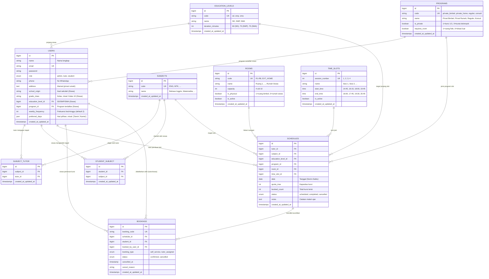

# Dokumen Perancangan Basis Data (Database Design Document)
## Sistem Penjadwalan Bimbingan Belajar ("Cinema Booking Model")

Dokumen ini merinci rancangan arsitektur basis data relasional untuk sistem penjadwalan bimbingan belajar, mencakup struktur tabel, tipe data, indeks, relasi (*Foreign Keys*), *constraint integrity*, aturan profil siswa (8 data utama), serta strategi DBMS (**MySQL** aktif & **Supabase** untuk persiapan masa depan).

---

## 1. Strategi & Konfigurasi DBMS

### 1.1 DBMS Aktif: MySQL
- **Engine:** InnoDB (dukungan penuh ACID transaction & Foreign Key constraints).
- **Charset / Collation:** `utf8mb4` / `utf8mb4_unicode_ci`.
- **Target Pengembangan:** Lokal & Server Standar (XAMPP / Laragon / Docker MySQL).

### 1.2 DBMS Persiapan Masa Depan: Supabase (PostgreSQL Cloud)
*(Disimpan sebagai catatan persiapan migrasi / cloud database di masa mendatang)*

```ini
# ==========================================
# CATATAN PERSIAPAN SUPABASE (POSTGRESQL)
# (Aktifkan saat siap migrasi ke Cloud Supabase)
# ==========================================
# DB_CONNECTION=pgsql
# DB_HOST=aws-0-ap-southeast-1.pooler.supabase.com
# DB_PORT=5432
# DB_DATABASE=postgres
# DB_USERNAME=postgres.your-project-ref
# DB_PASSWORD=your-secure-password
#
# Catatan Kompatibilitas Supabase:
# 1. Tipe data JSON di MySQL kompatibel dengan tipe JSONB di Supabase.
# 2. ENUM di MySQL dapat dipetakan ke VARCHAR dengan check constraint atau Postgres custom ENUM.
# 3. Fitur Realtime Supabase dapat dimanfaatkan untuk live seat update (kursi terisi real-time).
```

---

## 2. Diagram Relasi Entitas (Entity-Relationship Diagram / ERD)



---

## 3. Rincian Kamus Data (Data Dictionary)

### 3.1 Tabel `users` (Admin, Tutor, & Murid)
Tabel ini memuat akun seluruh pengguna sekaligus menampung data profil lengkap murid.

| Kolom | Tipe Data MySQL | Nullable | Keterangan & Pemetaan Kebutuhan |
| :--- | :--- | :---: | :--- |
| `id` | BIGINT UNSIGNED | Tidak | Primary Key, Auto Increment |
| `name` | VARCHAR(100) | Tidak | **1. Nama** lengkap pengguna |
| `email` | VARCHAR(150) | Tidak | Unique, kredensial login |
| `password` | VARCHAR(255) | Tidak | Hash kata sandi |
| `role` | ENUM('admin','tutor','student') | Tidak | Peran otorisasi |
| `phone` | VARCHAR(20) | Ya | Nomor WhatsApp/telepon |
| `address` | TEXT | Ya | Alamat lengkap (krusial untuk program Privat Rumah) |
| `school_origin` | VARCHAR(100) | Ya | **2. Asal Sekolah** (khusus murid, misal: "SMAN 1", "SMPN 3") |
| `grade_class` | VARCHAR(50) | Ya | **3. Kelas** (khusus murid, misal: "Kelas 10", "Kelas 12") |
| `education_level_id` | BIGINT UNSIGNED | Ya | Foreign Key ke `education_levels.id` (**Durasi** otomatis ikut jenjang) |
| `program_id` | BIGINT UNSIGNED | Ya | **4. Program** terdaftar siswa (FK ke `programs.id`) |
| `weekly_frequency` | TINYINT UNSIGNED | Tidak | **6. Frekuensi** les per minggu (Default: `2` jadwal/minggu) |
| `preferred_days` | JSON | Ya | **8. Hari Pilihan** preferensi siswa (misal: `["Senin", "Kamis"]`) |
| `created_at` / `updated_at` | TIMESTAMP | Ya | Audit trail |

> **Catatan 8 Atribut Profil Murid:**
> 1. **Nama:** `users.name`
> 2. **Asal Sekolah:** `users.school_origin`
> 3. **Kelas:** `users.grade_class`
> 4. **Program:** `users.program_id` (relasi ke `programs`)
> 5. **Pelajaran:** Relasi many-to-many melalui tabel pivot `student_subject`
> 6. **Frekuensi:** `users.weekly_frequency` (default: 2)
> 7. **Durasi:** Ditentukan otomatis oleh jenjang di `education_levels.duration_minutes` (SD: 60 mnt, SMP & SMA: 75 mnt)
> 8. **Hari Pilihan:** `users.preferred_days` (disimpan dalam format JSON array hari)

- **Indeks MySQL:**
  - `UNIQUE INDEX users_email_unique (email)`
  - `INDEX users_role_index (role)`
  - `INDEX users_education_level_id_index (education_level_id)`
  - `INDEX users_program_id_index (program_id)`

---

### 3.2 Tabel `education_levels` (Master Jenjang)
Menyimpan jenjang pendidikan beserta aturan durasi belajar per pertemuan.

| Kolom | Tipe Data MySQL | Nullable | Keterangan |
| :--- | :--- | :---: | :--- |
| `id` | BIGINT UNSIGNED | Tidak | Primary Key |
| `code` | VARCHAR(20) | Tidak | Unique (`sd`, `smp`, `sma`) |
| `name` | VARCHAR(50) | Tidak | Label (`SD`, `SMP`, `SMA`) |
| `duration_minutes` | INT UNSIGNED | Tidak | **7. Durasi Belajar**: SD (60 menit), SMP (75 menit), SMA (75 menit) |
| `created_at` / `updated_at` | TIMESTAMP | Ya | Audit trail |

---

### 3.3 Tabel `rooms` (Master Ruangan Bimbel)
Menyimpan 8 ruangan fisik bimbel serta 1 entitas ruangan non-fisik (Rumah Siswa).

| Kolom | Tipe Data MySQL | Nullable | Keterangan |
| :--- | :--- | :---: | :--- |
| `id` | BIGINT UNSIGNED | Tidak | Primary Key |
| `code` | VARCHAR(20) | Tidak | Unique (`R1` s/d `R8`, `EXT_HOME`) |
| `name` | VARCHAR(50) | Tidak | Nama ruangan ("Ruang 1" s/d "Ruang 8", "Rumah Siswa") |
| `capacity` | INT UNSIGNED | Tidak | Kapasitas: R1 (5), R2 (5), R3 (8), R4 (7), R5 (8), R6 (4), R7 (8), R8 (10), EXT_HOME (1) |
| `is_physical` | BOOLEAN | Tidak | `1` = Ruang fisik bimbel (R1-R8), `0` = Rumah Siswa |
| `is_active` | BOOLEAN | Tidak | Default `1` |
| `created_at` / `updated_at` | TIMESTAMP | Ya | Audit trail |

---

### 3.4 Tabel `time_slots` (Master 4 Sesi Waktu Harian)
Menyimpan definisi slot jam operasional bimbel harian.

| Kolom | Tipe Data MySQL | Nullable | Keterangan |
| :--- | :--- | :---: | :--- |
| `id` | BIGINT UNSIGNED | Tidak | Primary Key |
| `session_number` | TINYINT UNSIGNED | Tidak | Unique (1, 2, 3, 4) |
| `name` | VARCHAR(50) | Tidak | Nama sesi ("Sesi 1", "Sesi 2", dll.) |
| `start_time` | TIME | Tidak | Jam mulai (`14:45:00`, `16:15:00`, `18:00:00`, `19:45:00`) |
| `end_time` | TIME | Tidak | Jam selesai (`16:00:00`, `17:45:00`, `19:30:00`, `20:45:00`) |
| `is_active` | BOOLEAN | Tidak | Default `1` |
| `created_at` / `updated_at` | TIMESTAMP | Ya | Audit trail |

---

### 3.5 Tabel `subjects` (Master Mata Pelajaran)
Menyimpan 8 mata pelajaran bimbel.

| Kolom | Tipe Data MySQL | Nullable | Keterangan |
| :--- | :--- | :---: | :--- |
| `id` | BIGINT UNSIGNED | Tidak | Primary Key |
| `code` | VARCHAR(20) | Tidak | Unique (`ENG`, `IND`, `MTK`, `GEO`, `SOC`, `EKO`, `AKT`, `KIM`) |
| `name` | VARCHAR(100) | Tidak | Nama lengkap mapel |
| `created_at` / `updated_at` | TIMESTAMP | Ya | Audit trail |

---

### 3.6 Tabel `subject_tutor` (Pivot Mapel & Pengajar)
Menghubungkan tutor dengan mata pelajaran yang diajarkannya (relasi Many-to-Many).

| Kolom | Tipe Data MySQL | Nullable | Keterangan |
| :--- | :--- | :---: | :--- |
| `id` | BIGINT UNSIGNED | Tidak | Primary Key |
| `subject_id` | BIGINT UNSIGNED | Tidak | FK ke `subjects.id` (ON DELETE CASCADE) |
| `tutor_id` | BIGINT UNSIGNED | Tidak | FK ke `users.id` (ON DELETE CASCADE) |
| `created_at` / `updated_at` | TIMESTAMP | Ya | Audit trail |

- **Indeks Unik:** `UNIQUE (subject_id, tutor_id)`

---

### 3.7 Tabel `student_subject` (Pivot Mapel yang Diambil Murid)
**5. Pelajaran:** Menyimpan daftar mata pelajaran yang diambil/diminati oleh masing-masing siswa.

| Kolom | Tipe Data MySQL | Nullable | Keterangan |
| :--- | :--- | :---: | :--- |
| `id` | BIGINT UNSIGNED | Tidak | Primary Key |
| `student_id` | BIGINT UNSIGNED | Tidak | FK ke `users.id` (Siswa, ON DELETE CASCADE) |
| `subject_id` | BIGINT UNSIGNED | Tidak | FK ke `subjects.id` (ON DELETE CASCADE) |
| `created_at` / `updated_at` | TIMESTAMP | Ya | Audit trail |

- **Indeks Unik:** `UNIQUE (student_id, subject_id)`

---

### 3.8 Tabel `programs` (Master Program Belajar)
Menyimpan kategori program bimbingan belajar.

| Kolom | Tipe Data MySQL | Nullable | Keterangan |
| :--- | :--- | :---: | :--- |
| `id` | BIGINT UNSIGNED | Tidak | Primary Key |
| `code` | VARCHAR(30) | Tidak | Unique (`private_bimbel`, `private_home`, `reguler`, `consult`) |
| `name` | VARCHAR(50) | Tidak | Nama tampilan program |
| `is_private` | BOOLEAN | Tidak | `1` = Mengunci slot 1/1, `0` = Kuota kelompok |
| `requires_room` | BOOLEAN | Tidak | `1` = Mengunci ruangan fisik bimbel, `0` = Di rumah siswa |
| `created_at` / `updated_at` | TIMESTAMP | Ya | Audit trail |

---

### 3.9 Tabel `schedules` (Slot Tayang / Showtimes Kalender)
Tabel inti yang menyimpan slot jadwal yang dibuka mandiri oleh pengajar.

| Kolom | Tipe Data MySQL | Nullable | Keterangan |
| :--- | :--- | :---: | :--- |
| `id` | BIGINT UNSIGNED | Tidak | Primary Key |
| `tutor_id` | BIGINT UNSIGNED | Tidak | FK ke `users.id` (Tutor pembuat slot) |
| `subject_id` | BIGINT UNSIGNED | Tidak | FK ke `subjects.id` |
| `education_level_id` | BIGINT UNSIGNED | Tidak | FK ke `education_levels.id` (SD / SMP / SMA) |
| `program_id` | BIGINT UNSIGNED | Tidak | FK ke `programs.id` |
| `room_id` | BIGINT UNSIGNED | Tidak | FK ke `rooms.id` (R1-R8 atau EXT_HOME) |
| `time_slot_id` | BIGINT UNSIGNED | Tidak | FK ke `time_slots.id` (Sesi 1-4) |
| `date` | DATE | Tidak | Tanggal pelaksanaan (Senin s/d Sabtu) |
| `quota_max` | INT UNSIGNED | Tidak | Batas maksimal peserta |
| `booked_count` | INT UNSIGNED | Tidak | Default `0` (Denormalisasi counter jumlah kursi terpesan) |
| `status` | ENUM('scheduled','completed','cancelled') | Tidak | Default `'scheduled'` |
| `notes` | TEXT | Ya | Catatan materi ajar yang diisi tutor setelah sesi selesai |
| `created_at` / `updated_at` | TIMESTAMP | Ya | Audit trail |

- **Indeks Performa & Integritas:**
  - `INDEX idx_schedules_search (date, education_level_id, status)` (Query cepat katalog murid)
  - `INDEX idx_tutor_schedule (tutor_id, date, time_slot_id)` (Pencegahan bentrok tutor)
  - `INDEX idx_room_schedule (room_id, date, time_slot_id)` (Pencegahan bentrok ruangan)

---

### 3.10 Tabel `bookings` (Tiket Kursi Murid)
Menyimpan transaksi booking kursi murid pada slot jadwal tertentu.

| Kolom | Tipe Data MySQL | Nullable | Keterangan |
| :--- | :--- | :---: | :--- |
| `id` | BIGINT UNSIGNED | Tidak | Primary Key |
| `booking_code` | VARCHAR(30) | Tidak | Unique code (misal: `BKG-20261011-0001`) |
| `schedule_id` | BIGINT UNSIGNED | Tidak | FK ke `schedules.id` (ON DELETE CASCADE) |
| `student_id` | BIGINT UNSIGNED | Tidak | FK ke `users.id` (Siswa peserta) |
| `booked_by_user_id` | BIGINT UNSIGNED | Tidak | FK ke `users.id` (Siapa yang menginput: Siswa atau Tutor) |
| `booking_type` | ENUM('self_service','tutor_assigned') | Tidak | Cara pendaftaran |
| `status` | ENUM('confirmed','cancelled') | Tidak | Default `'confirmed'` |
| `cancelled_at` | TIMESTAMP | Ya | Waktu pembatalan (wajib $\ge$ H-1) |
| `cancel_reason` | VARCHAR(255) | Ya | Alasan pembatalan |
| `created_at` / `updated_at` | TIMESTAMP | Ya | Audit trail |

- **Constraint Unik:**
  - `UNIQUE (schedule_id, student_id)`: Mencegah 1 siswa memesan slot yang sama dua kali.

---

## 4. Logika Integritas & Aturan Query di Level Database

### 4.1 Validasi Anti-Bentrok Tutor & Ruangan
```sql
-- 1. Deteksi bentrok Tutor:
SELECT COUNT(*) FROM schedules 
WHERE tutor_id = :tutor_id 
  AND date = :date 
  AND time_slot_id = :time_slot_id 
  AND status != 'cancelled';

-- 2. Deteksi bentrok Ruangan Fisik (R1-R8):
SELECT COUNT(*) FROM schedules 
JOIN rooms ON schedules.room_id = rooms.id
WHERE schedules.room_id = :room_id 
  AND rooms.is_physical = 1
  AND schedules.date = :date 
  AND schedules.time_slot_id = :time_slot_id 
  AND schedules.status != 'cancelled';
```

### 4.2 Validasi Kuota Mingguan Siswa (`users.weekly_frequency`)
```sql
-- Hitung total booking aktif siswa dalam minggu berjalan (Senin-Sabtu):
SELECT COUNT(*) FROM bookings
JOIN schedules ON bookings.schedule_id = schedules.id
WHERE bookings.student_id = :student_id
  AND bookings.status = 'confirmed'
  AND schedules.status != 'cancelled'
  AND schedules.date BETWEEN :start_of_week AND :end_of_week;

-- Kondisi: Tolak booking jika COUNT >= users.weekly_frequency (default: 2)
```

### 4.3 Validasi Pembatalan H-1
```sql
-- Dihitung berdasarkan selisih tanggal sesi dengan tanggal hari ini:
-- DIIZINKAN jika: DATEDIFF(schedule.date, CURRENT_DATE) >= 1
-- DITOLAK jika: DATEDIFF(schedule.date, CURRENT_DATE) < 1 (Hari H)
```

---

## 5. Rencana Data Seeder Awal (*Seeders Mapping*)

1. **Jenjang (`education_levels`):** SD (60 mnt), SMP (75 mnt), SMA (75 mnt).
2. **Ruangan (`rooms`):** R1 (5), R2 (5), R3 (8), R4 (7), R5 (8), R6 (4), R7 (8), R8 (10), EXT_HOME (1).
3. **Sesi Waktu (`time_slots`):** Sesi 1 (14:45–16:00), Sesi 2 (16:15–17:45), Sesi 3 (18:00–19:30), Sesi 4 (19:45–20:45).
4. **Mata Pelajaran (`subjects`):** Bahasa Inggris, Bahasa Indonesia, Matematika, Geografi, Sosiologi, Ekonomi, Akuntansi, Kimia.
5. **Pemetaan Pengajar (`subject_tutor`):**
   - **Inggris:** Zaki, Sitey, Ainy, Fina, Acep, Cahya
   - **Indonesia:** Fahmi, Alifa, Nurul
   - **Matematika:** Resha, Ajun, Resti, Isma
   - **Geografi:** Ira
   - **Sosiologi:** Ira, Acep
   - **Ekonomi:** Selva
   - **Akuntansi:** Selva
   - **Kimia:** Ayuni
6. **Program Belajar (`programs`):** Privat Bimbel, Privat Rumah, Reguler, Konsultasi.
